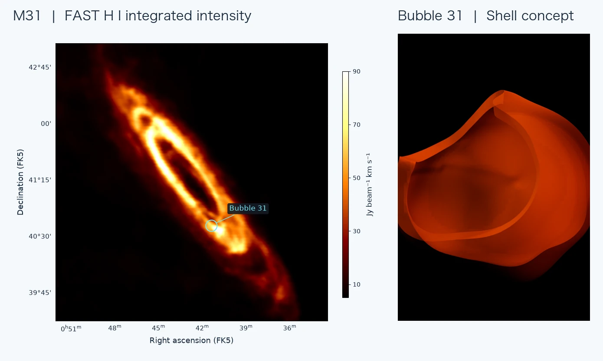
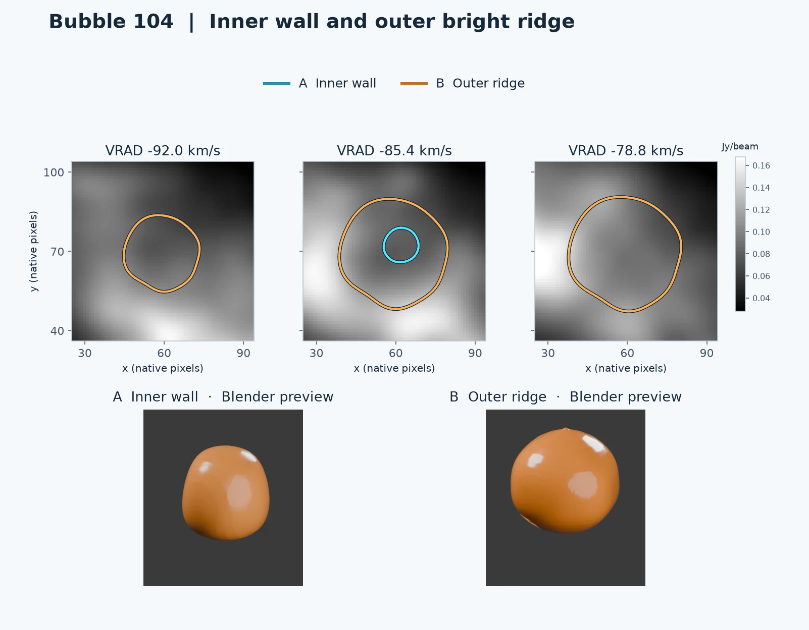
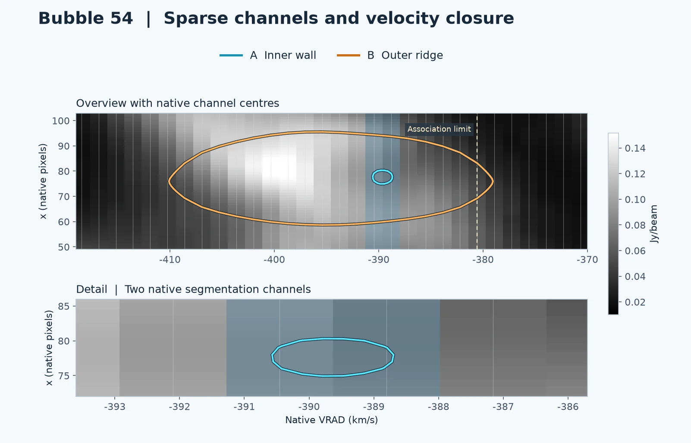
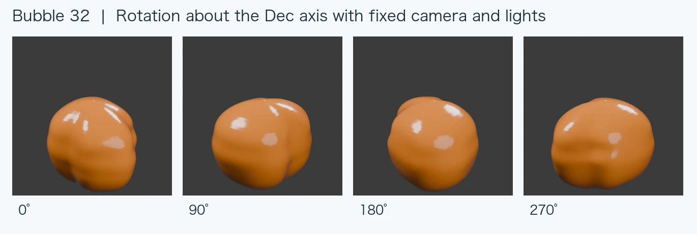
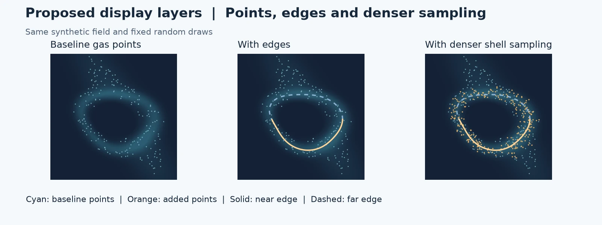

# Visualizing M31 H I superbubbles in 3D

*Collaboration specification for the Bailes team · English discussion draft · 12 November 2026*

The prototype should let a viewer locate a superbubble on an M31 H I map, open its local position–position–velocity (PPV) scene, and follow the same part of the shell as it rotates. A clipping plane or channel selector should expose the cavity and let the viewer check the shell against the observed emission. Bubble 31 and Bubble 104 are the first examples. For each object, compare the inner wall of the low-emission cavity and the bright ridge around it under a common coordinate system and camera setup.



**Figure 1. From the galaxy map to the shell.** The left panel is an integrated H I intensity map of M31, shown in CARTA. Blue marks the area outside the displayed coverage. The right panel is an early Blender concept for Bubble 31. Projected emission guides its detail, while the shell depth and cutaway are set for the illustration. The two panels use independent framing. In the prototype, the locator on the galaxy map comes from the catalogue position and the map world coordinate system (WCS). [Figure provenance](figure-sources.md#figure-1-m31-map-and-bubble-31-concept)

[中文讨论稿](README.zh-CN.md) · [Figure provenance and historical implementation](figure-sources.md)

## Scope and interfaces

The starting data are the H I velocity cubes and cutouts already available to the collaborating team. The prototype can be built around four components. A renderer can work from frozen geometry and sample assets while the geometry methods are still being compared.

| Component | Inputs | Outputs |
| --- | --- | --- |
| Data and coordinates | FITS cube or cutout, valid-data mask, catalogue and optional locator map | Normalized data and metadata, stable object identity, reversible mapping between native samples and the PPV scene |
| Geometry | Normalized cutout, catalogue association and method settings | Inner-wall or outer-ridge geometry, native channel overlays, data-support annotations and geometry diagnostics |
| Display and interaction | Geometry, volume, points and edges in the same scene coordinates | A scene with object selection, layer toggles, clipping and access to the native channels. Display presets and camera settings are stored independently of geometry |
| Comparison and validation | Fixed input, geometry and display presets | Channel overlays, coordinate checks, fixed-camera views and a turntable, with enough provenance to reproduce the comparison |

### Data and coordinate contract

The three scene axes represent two positions on the sky and the observed line-of-sight velocity. The displayed depth is a scaled velocity difference. Save the scale, sign and zero point so that a scene position can be converted back to km/s. Near and far refer to the PPV camera. Physical distances along the line of sight require additional information. The prototype animates the camera or rotates the scene. Simulating gas motion would require a separate model.

At ingest, record the FITS product identifier and SHA-256, HDU, shape, WCS, `BUNIT`, beam, spectral-axis type and units, channel spacing, effective spectral resolution, velocity reference frame and valid-data mask. In Python, use `[velocity, y, x]` with zero-based indices and apply the same axis operations to data and masks. Use `cand_label` (`CANDxxx`) as the stable key. Store the catalogue version, numeric bubble ID and any component identifier separately. Numeric IDs can recur, and some historical cutouts contain several components. [Final catalogue](../../code/m31_bubble_catalog_final_yes_118.tab) · [Column definitions](../../code/CATALOG.md)

Keep the FITS WCS, the cutout-to-parent index mapping and the local PPV-to-scene transform explicit. A shared PPV scene uses a common sky coordinate convention, velocity zero point and velocity scale across objects. For individual views, define the display aspect ratio as `d = displayed velocity span / sqrt(displayed sky width × displayed sky height)`. Historical single-object targets were 1.00 for the inner wall and 1.03 for the bright ridge. Values of 0.7, 1.0 and 1.3 are comparison settings for a single-object panel. Save the actual transform and label any independently scaled view.

## Geometry alternatives

A cavity appears as a region of low H I emission. Interpret it in conjunction with the surrounding bright wall, adjacent native channels and catalogue association. The beam, spectral response, overlapping components, self-absorption and sensitivity to different spatial scales all affect the apparent boundary. Each geometry product should retain the information needed to distinguish the rendered surface, the native data that support it and any part supplied by a shape prior.



**Figure 2. Two boundaries for Bubble 104.** Cyan marks the cavity inner wall and orange marks the outer bright-ridge envelope. Both are intersections of historical meshes with the same native channel planes, plotted with a common intensity scale. The inner-wall mesh intersects the middle channel in this set. The lower panels show historical Blender previews framed independently for shape comparison. A uses `surface=0.30`, `roundness=0.80` and `depth=1.00`. B uses a ridge-presence threshold fraction of 0.18, `hybrid` closure and `depth=1.03`. [Data, parameters and overlay method](figure-sources.md#figure-2-bubble-104-route-comparison)

### A. Inner wall of the cavity

Start from the catalogue position projected through the cutout WCS and inspect the low-emission core across consecutive channels. The historical method samples 360 azimuths about a fixed centre and uses the positive radial intensity gradient from cavity to wall to locate an inner edge. The simplified selection below applies where the wall-to-core contrast is measurable above the noise.

```text
u = clip((I - C) / (W - C), 0, 1)
cavity_score = (1 - u) * P(v) * Tq(r)
candidate = cavity_score >= 1 - surface
```

`C` and `W` are estimates of the core and wall intensities, `P(v)` weights channel support, and `Tq(r)` is a radial taper controlled by `roundness`. Within the search region, select a connected component associated with the seed and extract the surface after limited morphological processing and distance-field smoothing. A translucent surface, outline or cutaway can expose the space it encloses.

| Control | Historical setting | Comparison |
| --- | --- | --- |
| Centre, velocity window and inner-wall search radius | Catalogue position with a local channel check | Hold them fixed while testing the scoring parameters. Check native channels just beyond both ends |
| `surface` | 0.30 | Compare 0.20, 0.30 and 0.40. Lower values typically select a darker and smaller core |
| `roundness` | Usually 0.80. The first batch used 0.50 when the estimated inner radius was below about 0.8 beam FWHM | Compare 0, 0.50 and 0.80 after settling the threshold. Check how the taper affects asymmetry and the offset from the observed wall |

### B. Outer bright ridge

Use the catalogue centre, ellipse semiaxes and position angle to define a search band. Convert the sky position angle to the array convention through the WCS. Search for a radial intensity peak at each azimuth and channel, then estimate its contrast relative to the neighbouring emission. Select a contiguous velocity range containing the associated peak. The historical radial representation assumes a fixed centre and a single radius per azimuth. A strongly concave, overlapping or multiply connected shell may need separate components or another segmentation method.

| Control | Historical setting | Comparison |
| --- | --- | --- |
| Ridge search radius, ellipse and position angle | Object-specific | Estimate independently of the inner-wall radius. Report where the ridge estimate departs from the prior |
| `presence-threshold-fraction` | 0.18 of the range between robust low and high channel-contrast estimates | Inspect the contrast curve and check whether the supported interval survives small changes to the fraction |
| Extension of the catalogue interval | At most six native channels | Record an endpoint limited by this rule separately from the measured support |
| Analysis-window padding | Start with 12 native channels, increase in steps of four, up to 32 | Expand if supported signal reaches the analysis boundary and native data are available. Flag a truncated search when coverage ends |
| `closure-profile` | `hybrid` | Compare with `contrast` on the same supported interval. Save the radial scale versus velocity and the native channel overlays |
| Display subdivision | One level | Keep the geometry before display subdivision for comparison |

The `contrast` profile changes the radius with the channel contrast. Multiple contrast peaks can produce stacked bulges. The `ellipsoid` profile applies a smooth taper to the selected interval, padded by up to one channel at either end. The `hybrid` profile multiplies that taper by `0.90 + 0.10 × Cscale` and normalizes the result. Here `Cscale` is the smoothed and transformed contrast scale. The taper incorporates a shape prior. Preserve open geometry where the data support an opening, and mark the added faces in any closed display variant. [Historical implementation index](figure-sources.md#historical-implementation)

## Reference cases and comparison design

| Object | Role in the comparison | What to look for |
| --- | --- | --- |
| Bubble 31 / CAND238 | Galaxy locator, cutaway and a first comparison of A and B | Can the viewer locate the object, recognize the cavity and follow the same wall through a rotation? |
| Bubble 104 / CAND021 | Comparison of A and B on the same native channels | Where do the inner wall and ridge intersect the emission, and which parts depend on the closure profile? |
| Bubble 54 / CAND067 | Case with sparse native velocity coverage of the inner wall | How does thresholding shape the ends, and how is that shown to the viewer? Match the sky position because two catalogue entries use the number 54 |
| A cutout with overlapping components, for example in the Bubble 95 region | Shared scene with several objects | Do component assignment, object picking and occlusion work on a common velocity axis? |

The historical cutouts provide reference results. Match the available inputs to the catalogue by position and velocity and compute new pixel positions from the actual WCS.



**Figure 3. Velocity endpoints for Bubble 54.** The cyan inner-wall cross-section occupies a narrow range supported by two native segmentation channels, shaded blue. The lower panel enlarges that region. Orange is the `hybrid` ridge envelope. The light dashed line marks the high-velocity limit on the associated support interval, and the smooth envelope extends past it as part of the closure construction. The horizontal axis is the observed radio velocity (VRAD) in km/s. [Source cutout and support intervals](figure-sources.md#figure-3-bubble-54-velocity-endpoints)

With sparse velocity coverage, a thresholded cross-section can vanish between adjacent channels and leave a nearly planar end. Bubble 54 and component B in the historical `bubble95multi` cutout each retained two native channels in the inner-wall segmentation. Fivefold spectral interpolation and distance-field smoothing can soften that appearance. The native sampling and spectral response still determine the available velocity information. Compare the ends with the native slices before interpreting their shape.

The first inner-wall batch produced 16 meshes from nine cutouts and all passed the watertight edge-count check. The first outer-ridge batch yielded 17 closed components. The later 118-object ridge batch recorded 13 geometry successes, 97 review cases and eight failures. Blender rendered 110 objects. Retaining the observational review status alongside the render status makes it possible to use a scene for visual comparison while tracking questions about its geometry. [Historical batch records](figure-sources.md#historical-implementation)



**Figure 4. A turntable reference.** The Bubble 32 ridge model (CAND074) rotates about the displayed Dec axis with fixed camera and lighting. All four panels use the same crop. The geometry carries a review flag. Use the sequence as a framing and shape-tracking reference when adding translucent gas and shell layers. [Four-view render provenance](figure-sources.md#figure-4-bubble-32-four-views)

## Rendering and depth cues

The open question is how well a viewer can follow foreground and background structure through translucent gas. Compare the gas layer alone, then with baseline points, edges, extra points near the shell and the combined preset. Hold geometry, camera, lighting, exposure and the base transfer function fixed across the comparison. A fixed model with a moving camera also reveals parallax and compositing behaviour. Start with depth of field and strong bloom disabled.



**Figure 5. Proposed display layers on a synthetic example.** The same field and baseline point sample appear in all three panels. Dashed and solid edges illustrate the far and near sides in the chosen view. Additional points concentrate around the shell, leaving the low-emission interior open. [Schematic provenance](figure-sources.md#figure-5-proposed-points-edges-and-sampling)

| Layer | Intended signal and controls |
| --- | --- |
| Gas and baseline points | Sample valid emitting voxels using a fixed seed. Shell-surface points can be a separate layer with their own source coordinates and weights |
| Sky-plane intensity edges | Estimate `∇sky I` at a beam-related scale after a signal-to-noise gate. Check shifts induced by smoothing |
| Spectral and velocity cues | Export `∂I/∂v` for variation across channels and `∇sky〈v〉` for the sky-plane gradient of a reliable velocity centroid. Use native channel views to inspect multiple spectral components |
| Ridge traces and silhouettes | Store observed ridge traces independently of view-dependent mesh silhouettes |
| Higher sampling density near the shell | Add points near a wall or ridge that passes the signal gate. Track projected brightness, point count and the achieved density increase |

An initial sampling rule is `p = clip(p0 × (1 + a_edge × E + a_bubble × B), 0, 1)`, where `p0` is the baseline inclusion probability in valid emission and `E` and `B` are edge and neighbourhood weights in `[0, 1]`. Reuse the same per-sample random draw so the point sets remain stable and nested as probabilities rise. Compare about 1×, 2× and 4× local density, and record the achieved factors when probabilities saturate. If combining sky and spectral gradients, normalize their scales using the beam and effective spectral resolution and record the units and weights.

A preset designed to preserve intensity can use `I/p` for a linear sum over selected samples. Alpha compositing also depends on point footprint and draw order. Calibrate it and compare projected intensities from fixed views. A separate structure-emphasis preset can use an explicit, recorded gain.

| Control | Suggested comparison values |
| --- | --- |
| Emission gate | Local signal-to-noise ratio of 2, 3 and 5. Estimate noise in valid line-free regions and record the smoothing state |
| Extra smoothing | Spatial kernel FWHM of 0, 0.5 or 1 beam. Spectral kernel FWHM of 0, 0.5 or 1 effective resolution element. Record the resulting resolution |
| Edge gate | 70th, 85th and 95th percentiles within the signal mask |
| Camera and point size | Vertical field of view of 30°, 45° or 60°, with an orthographic reference. About 1–3 px point diameter and line width at 1080p |
| Volume step | 0.5–1 times the smallest displayed voxel dimension. Recalibrate brightness as the step changes, for example with `alpha = 1 − exp(−κΔs)` for a chosen transfer function |

The scene should support object picking, layer toggles, preset or threshold selection, velocity range, clipping, opacity and camera reset. Picking should expose the stable catalogue ID, velocity interval and review status. Use the native-channel view to follow the source of an outline. Test transparency with intersecting shells and gas across the full turntable, where ordering errors are easiest to see.

## Asset exchange

Python can produce the normalized data, geometry, sample positions and diagnostics. Unity, Blender or another renderer can consume them and implement the camera, materials and interaction. Lock the file formats and engine version after a round-trip test with one real object.

| Asset | Candidate format | Required semantics |
| --- | --- | --- |
| Volume | FITS reference and numeric volume texture | Intensity and valid-data mask, optional support field, shape, axis order, dtype, byte order and sampling convention |
| Mesh | OBJ or agreed GLB, with sidecar attributes if needed | Vertices, triangles, normals, object/component IDs and a support or closure annotation on the relevant vertices or faces |
| Points and edges | NPZ or PLY for points, indexed line segments for edges | Scene coordinates, source voxel or parent references, intensity, velocity, inclusion probability or weight, layer type and support where applicable |
| Object manifest | JSON | Stable ID and catalogue version, source hash and HDU, transforms, method/version and parameters, native supported intervals, output assets, review status and reasons |
| Display preset | JSON or a versioned scene | Layer flags, transfer functions, seed and sampling level, camera, lighting, clipping and exposure |

Use explicit units and axis labels for all transforms. For a format check, round-trip at least three non-collinear sky points and two distinct native velocity positions through the import path. The target error is at most 0.5 native pixels or channels on each axis. Report resampling errors separately. Inspect normal orientation and handedness, confirm that the mesh, points, edges and volume line up, and exclude masked and non-finite values from emission sampling. In Unity, a point cache or a custom GPU buffer can carry point attributes. The importer needs a shared convention for velocity, weights and layer labels. [Unity VFX Graph point caches](https://docs.unity.cn/Packages/com.unity.visualeffectgraph%4010.6/manual/point-cache-in-vfx-graph.html)

## Evidence for reviewing the prototype

| Area | What the comparison should show |
| --- | --- |
| Geometry | Both routes for Bubbles 31 and 104 use the same input and display coordinates. Overlay the surfaces at central, end and weak-support channels. Record offsets, boundary or prior effects, openings and added closure faces. Report boundary edges, non-manifold edges, self-intersections and normal consistency separately from observational support |
| Display | Save the fixed-camera 0°, 90°, 180° and 270° views and a continuous turntable. Include a sparse-channel and an overlapping-component case. Check that landmarks remain trackable, transparency has no obvious jumps and the object stays in frame. Compare projected intensity before and after changing the sampling density |
| Reproduction | Record inputs and hashes, geometry version and settings, transforms, display preset, camera, and commands needed to reproduce the scene. Keep review and failure reasons with the object so a rerun can start from the affected stage |
| Performance | Record hardware, resolution, point and triangle counts, memory, load time, and median and 95th percentile frame times. Once the desktop GPU is agreed, 1080p at 30 fps is a proposed initial target |

The choices for the first discussion are the matched cutouts and catalogue revision, the shared velocity scale and legend, the target hardware and rendering pipeline, and the acceptable offsets and endpoint regularization. The bright ridge is a starting point for a shell overview, with the inner wall available for cavity inspection. The paired views provide the basis for deciding which representation best serves each view.
