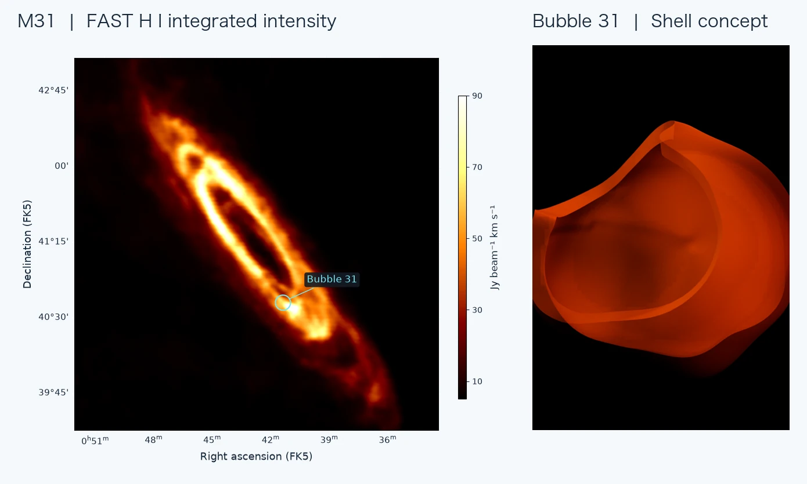
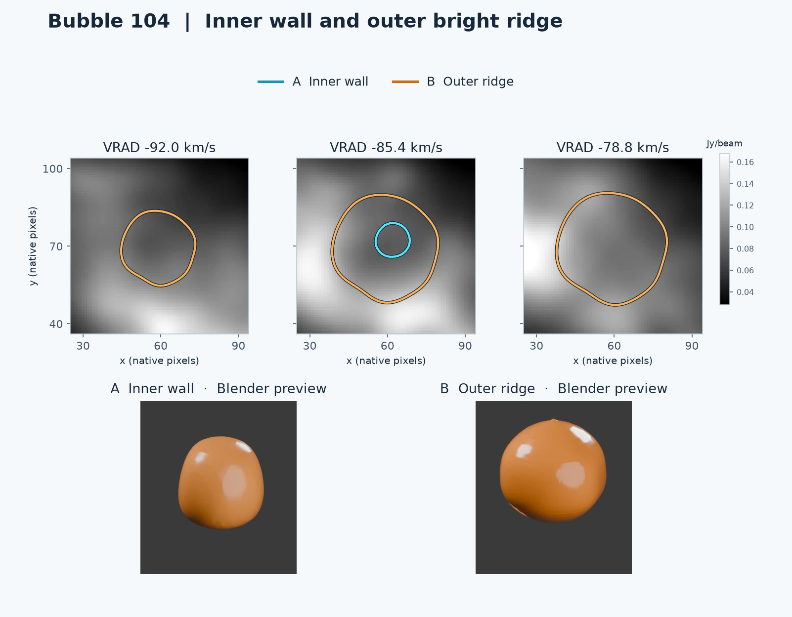
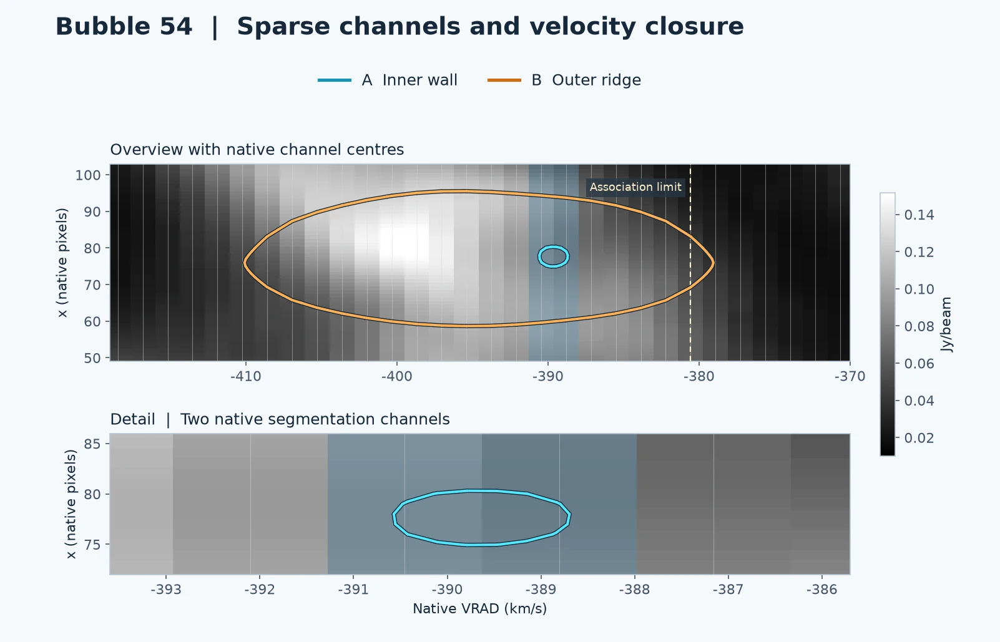
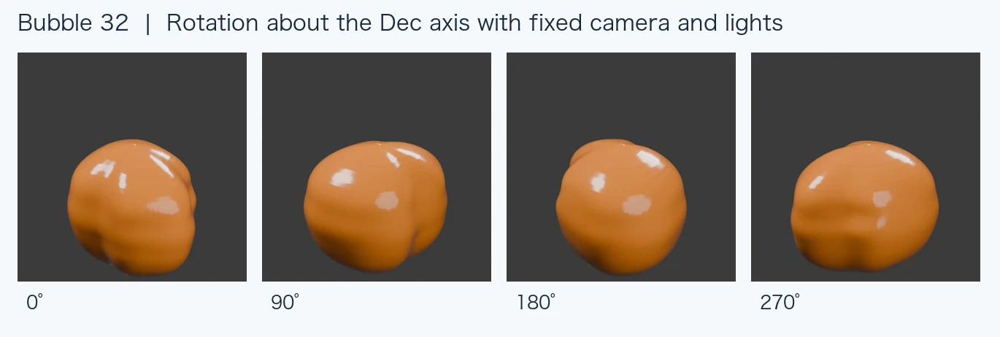
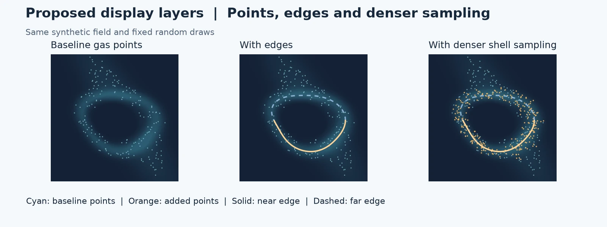

# M31 中性氢气泡三维可视化：开发规格与建模经验

**中文讨论稿 v0.2 · 2026 年 11 月 12 日 · 面向 Bailes 团队**

[English collaboration specification](README.md)

首轮原型是一套交互式三维查看器。观众从 M31 H I 星系图上找到气泡后，可以绕气泡自由转动，从侧面、上方和下方观察，并缩放到感兴趣的部位。剖切和观测通道用于检查空洞和壳壁。建议先用 Bubble 31 和 104，查看时可在**空洞内壁**与**外围亮脊**之间切换，并保持当前视角。



**图 1｜从星系定位到局部结构。** 左：M31 H I 积分强度图（CARTA 历史预览，蓝色为覆盖区外背景）；右：Bubble 31 早期 Blender 概念模型，由观测投影引导并设定壳深和剖开区域，用于展示开口与前后层次。两图为独立画幅。最终界面的定位框需用目录与观测图 WCS 计算，局部模型可放大并标注比例。[图件来源与制作方法](figure-sources.zh-CN.md)

本文将 **历史结果** 与 **拟议实验** 分开。两条几何路线已有 Blender 资产；点、边缘、气泡邻域加密与 Unity 接入为首轮拟议实验。实现可由双方选择，比较使用共同的输入和判据。

## 1. 统一数据和坐标

气泡几何建立在位置–位置–速度（PPV）空间：两个天空位置轴加一个观测视向速度轴。图中的显示深度是速度差乘一个显示比例，保存变换即可换算回 km/s。观测约束的是视向速度；沿视线的实际距离需要另外的物理信息。画面中的近侧、远侧和遮挡均相对于 PPV 相机。观众改变的是观察位置，数据和几何仍保留原有的 PPV 坐标。

空洞对应低 H I 发射区域。判读时同时检查周围亮壁、相邻原始通道与目录关联。波束、谱响应、谱线重叠、自吸收及观测对空间尺度的响应都会影响外观。轮廓、原始数据支持度和渲染透明度应分别显示与保存。

- **输入清单。** 以合作方已有的 H I 速度立方体及其切块为起点，先对齐文件名与 SHA-256、HDU、维度、WCS、BUNIT、波束、谱轴定义、通道间隔、有效谱分辨率、速度参考系、有效掩膜和目录版本。从 FITS 谱轴读取速度定义、单位和参考系，统一用 km/s 表示。Python 建议统一为 `[velocity, y, x]`、0 基像素索引；掩膜与属性同步重排。
- **对象识别。** 使用最终目录的 `cand_label`（`CANDxxx`）作稳定主键，另存数字编号、component 和切块版本。数字编号可能重复，历史切块也可能容纳多个 component。用 [最终 118 气泡目录](../../code/m31_bubble_catalog_final_yes_118.tab)及其[列定义](../../code/CATALOG.md)对齐中心和速度。
- **显示深度。** 定义 `d = 速度轴显示跨度 / sqrt(天空横向显示跨度 × 天空纵向显示跨度)`。历史单对象内壁模型多取 1.00，外围亮脊取 1.03。独立对象可试 0.7、1.0、1.3，保存实际值和速度转换系数。共同 PPV 场景使用同一速度零点和同一速度比例，保留对象之间的位置和速度关系。独立缩放用于比较板与局部放大。
- **配准。** 保存切块到母立方体的索引映射、天空定位图的 WCS 及从局部天空坐标和速度到渲染坐标的可逆变换。天球 WCS 与渲染坐标变换分开存放。

## 2. 两条几何路线



**图 2｜同一对象的两种边界。** 上：历史 `bubble104.fits` 的三个原始通道；青色线为低发射空洞的内缘，橙色线为外围亮脊包络，均由历史 OBJ 网格与通道平面求交。三幅共用强度色标；某通道超出一个模型的速度跨度时，该路线无交线。下：两个历史 Blender 预览独立取景，用于比较形态。A：`surface=0.30`、`roundness=0.80`、`depth=1.00`；B：亮脊支持阈值 0.18、`hybrid`、`depth=1.03`。两路线选取各自的边界和速度支持，渲染尺寸与体积不宜直接相比。[图件来源](figure-sources.zh-CN.md#图-2bubble-104-双路线)

### A. 空洞内壁：圈出低发射核心

从目录中心和切块 WCS 开始，在连续通道内检查低发射核心。历史引导在固定中心周围采样 360 个方位，用从核心到亮壁的正径向强度梯度定位内缘。每通道估计中心强度 `C(v)` 和周围壁强度 `W(v)`。在亮壁与核心的对比相对噪声足够明显时，概念上可写成：

```text
u = clip((I - C) / (W - C), 0, 1)
空洞得分 = (1 - u) × P(v) × Tq(r)
候选体素：空洞得分 ≥ 1 - surface
```

`P(v)` 是通道支持权重，`Tq(r)` 是由 `roundness` 控制的径向衰减。选与种子相关的连通域，做有限的形态处理及距离场平滑，再提取表面。模型表面代表空洞边界；展示建议用半透明、剖面或轮廓，让观众能看到壳壁包围的空间。

|参数|历史设置|本轮如何选|
|---|---|---|
|中心、速度区间、内壁搜索半径|目录起点加局部通道复核；用源切块像素定位|先固定这三项。中心落在跨通道稳定的核心，检查区间两端的邻近真实通道|
|`surface`|0.30|试 0.20、0.30、0.40；较低通常选更暗、更小的核心。按观测叠图选边界|
|`roundness`|通常 0.80；历史上内缘估计小于约 0.8 个波束 FWHM 时取 0.50|边界确定后试 0、0.50、0.80。比较各向异性细节和偏移，保留弱正则化对照|
|`depth`|1.00|在几何固定后调整显示比例|

### B. 外围亮脊：跟踪较亮壳壁

用目录中心、椭圆半轴和位置角约束搜索带。先把天球位置角经 WCS 转换成数组平面的角度，再逐通道、逐方位寻找径向峰，计算峰相对两侧背景的对比度。速度方向选出包含目录关联峰的连续支持段。历史模型使用固定中心和每个方位一个半径；明显凹陷、交叠或多连通结构需要拆分 component 或更一般的分割。

|参数|历史设置|本轮如何选|
|---|---|---|
|`ridge-radius`、半轴、PA|对象级估计，记录像素半径与角度|与内壁半径分开估计，检查亮脊偏离先验的位置|
|`presence-threshold-fraction`|0.18|基于通道对比度稳健高低值之间的比例；看支持段是否在小幅改动时稳定|
|关联区间外扩|最多 6 个原始通道|记录信号是否延伸到策略上限；原始数据支撑和关联截断分别标记|
|分析窗口 padding|历史亮脊配置从 12 个通道起、每次增 4、至多 32|从切块读取实际存在的邻近通道。窗口边界仍有支持时，扩大窗口或标记缺测|
|`closure-profile`|`hybrid`|同一支持段下与 `contrast` 比较端部及多峰造成的分层|
|渲染细分、`depth`|1 级、1.03|同时保留细分前几何和实际显示比例|

`contrast` 用各通道亮脊对比度调节半径，多峰时可能出现叠层鼓包。`ellipsoid` 在已选支持段两侧最多各延一通道，给出连续椭圆型收口；`hybrid` 在该收口上乘以 `0.90 + 0.10 × Cscale` 后归一化，`Cscale` 是平滑和变换后的对比度尺度。**收口形状包含正则化先验。** 复核时保存对比度曲线、支持段、收口函数和代表通道叠图。若只看到开口壳，保留开口版本；闭合展示资产另标出补合部分。[历史实现索引](figure-sources.zh-CN.md#历史实现索引)

## 3. 历史结果与压力测试



**图 3｜Bubble 54 的速度端部。** 在同一条原始 PV 切片上，青色为内壁截线，橙色为 `hybrid` 亮脊截线。蓝色窄带标出内壁分割保留的两个原始通道；下方放大框显示窄速度范围内的内壁形状。浅橙色虚线标出亮脊支持段在速度较高一端的关联外扩上限；平滑收口是该模型的几何构造。两条路线覆盖的速度跨度不同，横轴为未做展示拉伸的 VRAD。[图件来源](figure-sources.zh-CN.md#图-3bubble-54-速度端部)

少通道对象的截面会在跨过得分阈值时迅速消失，形成近似平面端部。历史内壁批次的 Bubble 54 与旧 `bubble95multi` 的 B component 都只有两个原始分割通道。五倍谱向插值和距离场平滑仍可留下此效应；谱向约束由原始通道与谱响应决定。先对照原始通道和切窗位置，再评估弱平滑、保留开口或加正则化收口。

|历史批次|产出|可复用经验|
|---|---|---|
|内壁首批|9 组切块、16 个网格；边计数检查均水密|少通道端盖与波束尺度下的正则化需要单独复核|
|亮脊首批|17 个 component 生成闭合网格|比较多峰分层、关联速度和端点；每条路线单独核对 component|
|亮脊 final118|几何 13 个 `success`、97 个 `review`、8 个 `failed`；Blender 成功 110 个|渲染成功与几何证据各有状态。保留复核原因、失败原因和可续跑记录|



**图 4｜供比较的四个历史视角。** final118 的 Bubble 32（CAND074）外围亮脊模型绕 Dec 显示轴旋转 0°、90°、180°、270°，灯光和相机固定，四幅统一裁切。该模型带几何复核标记。四张图提供可重复的对照视角，交互查看器应能连续改变方位角和俯仰角。[图件来源](figure-sources.zh-CN.md#图-4bubble-32-四视图)

首轮建议按下列对象对齐数据和配置。历史图使用旧切块，当前输入需按 WCS、目录与谱轴重新定位。

|对象|用途|优先检查|
|---|---|---|
|Bubble 31 / CAND238|从星系定位到局部展示|空洞是否容易辨认；两路线旋转时能否追踪同一结构|
|Bubble 104 / CAND021|两条路线比较|同一通道的内缘和亮脊、端部正则化、观测支持与先验的分界|
|Bubble 54 / CAND067，或旧 95 B|少通道压力测试|端盖、插值及光滑外观对观测证据的影响；用坐标确认重复编号 54|
|一个 multi 区域，例如 95 一带|重叠结构测试|component 归属、共同速度轴、遮挡和拾取|

## 4. 拟议实验：用点、边缘和局部加密建立层次

李菂老师建议增强气体的透视与前后层次，从点、边缘、阈值、速度梯度和气泡局部加密入手。建议将它们做成独立图层和开关。用同一视角或同一段相机轨迹比较「仅气体 → 加均匀点 → 加边缘 → 加气泡邻域点 → 组合」，并匹配几何、曝光和基础透明度。再自由转动和缩放，观察同一结构能否持续追踪，尤其是远侧壳壁在经过前景气体后能否再次辨认。



**图 5｜拟议方案，合成示意。** 用同一组模拟信号和稳定采样比较三种图层。虚线示意由当前视角看到的远侧边缘，较密的点集中在有信号的壳附近，空洞内部留白。这张图仅说明图层与采样策略，真实阈值和透视效果需要在观测数据上试验。

|显示信号|建议实现|科学解释与检查|
|---|---|---|
|基础气体点|从有效发射体素按固定种子采样；另设壳面点|两类点保存来源坐标、类别和权重；转台中保持点位置|
|天空平面强度边缘|在波束相关尺度计算 `∇sky I`，先用发射信噪比门控|追踪亮壁边界，检查噪声与局部平滑造成的偏移|
|谱向变化与速度梯度|分别输出 `∂I/∂v` 与可信的 `∇sky〈v〉`|前者为相邻通道的强度变化；后者为速度重心在天空平面的变化。多峰区优先逐通道检查|
|数据亮脊及轮廓|分别导出观测亮脊和视角相关的网格轮廓|用独立图层区分数据支持与相机描边|
|邻域加密|在通过发射门控的壳壁、亮脊附近提高点密度|低发射核心留白；记录加密前后投影亮度与点预算|

首轮可用 `p = clip(p0 × (1 + a_edge × E + a_bubble × B), 0, 1)`。基础概率 `p0` 覆盖有效发射，`E` 和 `B` 为 0–1 的边缘和气泡邻域权重。用固定的随机数决定入选，不同密度层可相互嵌套。先单独试开关，再调增益，使邻域点密度约为基础的 1、2、4 倍；概率饱和时记录实得倍率。若合成 PPV 梯度，按波束尺度和有效谱分辨率分别归一化后再组合，并保存权重与单位。

将「保持强度」与「结构强调」做成两个 preset。在线性发射和中可用入选点的 `I/p` 估计亮度；半透明 alpha 合成要按权重和点足迹重新标定，使用固定视角检查加密前后投影亮度。结构强调允许局部增益，增益随 preset 记录。

|控制项|建议比较起点|选择依据|
|---|---|---|
|发射门槛|局部 S/N 2、3、5|用无谱线有效区估计噪声，记录平滑前后阶段；看低亮度壳的连续性|
|额外平滑|空间核 FWHM 为 0、0.5、1 个波束；谱向为 0、0.5、1 个有效谱分辨单元|保留原生对照；报告合成后的有效分辨率，少通道对象优先弱平滑|
|梯度门槛|有效信号区的第 70、85、95 百分位|看边缘在小幅调参后是否仍可追踪|
|相机与点大小|垂直 FOV 30°、45°、60°，另存正交对照；1080p 点径和线宽约 1–3 px|比较透视、遮挡与可读性；保存 FOV 定义、投影、裁剪面和曝光|
|体渲染步长|最小显示体素尺度的 0.5–1 倍|换步长时用 `alpha = 1 − exp(−κΔs)` 一类形式校正亮度，`κ` 由显示传递函数给出|

查看器应支持以选中气泡或区域为中心绕行，方位角可完整转过 360°，俯仰角可连续改变，并提供平移、缩放、聚焦和复位。切换几何、图层或速度区间时保留当前视角和缩放。相机移动时实时更新遮挡、透明度合成与轮廓，数据点和亮脊继续与 PPV 坐标配准。四个预设角度或一段录制轨迹可用于重复比较。先关闭景深和强 bloom。通过壳面法线、有限明暗、深度测试和透明度让近侧与远侧可分辨；用剖切平面或可调通道打开内部。若透明对象排序出现跳变或丢层，评估渲染顺序、深度测试和透明合成方案，记录代价。

## 5. Python → Unity 或等效工具

Python 负责坐标、几何、采样和质量检查；渲染端读取资产，负责材质、灯光、相机与交互。调整显示参数复用几何；改变分割参数导出新几何版本。小样阶段先对齐一份真实资产的格式、手性和坐标，再定 Unity、Blender 或其他客户端的细节。

|资产|建议传输形式|最小字段|
|---|---|---|
|体数据|FITS 原件索引 + 数值体纹理|强度、有效掩膜、可选支持度；数组顺序、dtype、字节序、尺寸及取样方式|
|内壁/亮脊网格|OBJ 或双方确认的 GLB，另附属性|顶点、三角面、法线、component、顶点或面的支持度/补合标记|
|点与边缘|NPZ 或 PLY 中间资产，加渲染端导入器；有序索引线段|源索引或父体素、场景坐标、强度、速度、概率/权重和类别；边缘另存支持度|
|对象 manifest|JSON|目录主键、输入哈希、坐标映射、参数、算法版本、输出资产、质量状态与原因|
|显示 preset|JSON 或版本化场景|图层、传递函数、随机种子、点集等级、灯光、相机和剖切|

- **导入验证。** 用至少三个不共线的天空点和两个不同的速度位置做往返定位，覆盖轴交换、方向、手性、单位和法线。与源切片的误差目标为每轴 0.5 个原始像素或通道以内；记录重采样附加误差。先验或插值生成的点标明来源。点、线、网格和体纹理在共同坐标下应重合，掩膜外和 NaN 区域不参与发射采样。
- **Unity 接入。** VFX Graph [Point Cache](https://docs.unity.cn/Packages/com.unity.visualeffectgraph%4010.6/manual/point-cache-in-vfx-graph.html) 可通过属性图携带位置等点属性；速度、权重和类别由导入器约定，可采用属性纹理或 GPU buffer。先用两张交叠的半透明壳加体气体测试合成，再选择渲染管线和包版本。[Unity SortingCriteria](https://docs.unity3d.com/cn/current/ScriptReference/Rendering.SortingCriteria.html) 提供渲染排序接口，需在真实场景核对透明层。
- **查看器交互。** 自由绕行、平移、缩放、聚焦和复位，以及图层开关、对象拾取、阈值/preset、速度区间、剖切和透明度。拾取结果显示稳定 ID、速度范围、坐标含义及质量状态。观测通道视图随所选对象和通道更新。

## 6. 首轮交付与验收

1. **先验证几何。** 交付 31、104 的 A/B 小样，各带源通道叠图和模型参数。选中心、两端及弱支持通道，标出轮廓偏移、开口/补合、切窗和先验影响。闭合资产报告边界边、非流形边、自交和法线；几何 QA 与观测 QA 分别记录。
2. **再验证层次。** 在交互查看器里绕行一周、改变俯仰、拉近细节，再从当前视角切换几何和剖切或选通道。用少通道和多 component 样例检查点位、轮廓、透明合成和遮挡关系。用相同的预设视角或录制轨迹比较点、边缘与加密方案，复核投影强度和采样误差。
3. **最后验证交接。** 提供 Python 入口和依赖说明、版本化小样包、可运行场景、preset、对象与失败表，以及从输入到结果的重建命令。约定桌面 GPU 后可先以 1080p、30 fps 为目标，记录点面数、显存、加载时间及中位与第 95 百分位帧时间。批处理按对象和配置版本续跑。

首次讨论需共同确定：**数据切块和目录版本**（尤其是重复编号与 multi 的映射）、**共同速度比例和图例**、**目标硬件与渲染管线**、**可以接受的轮廓偏移和端部正则化**。建议先以外围亮脊做壳形概览、以内壁做空洞剖切，最终用途和主路线由同条件小样决定。

[配图来源、参数与历史实现索引](figure-sources.zh-CN.md)
